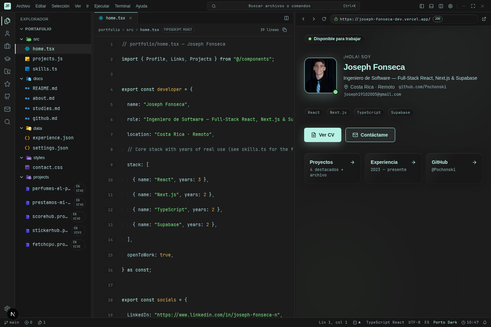
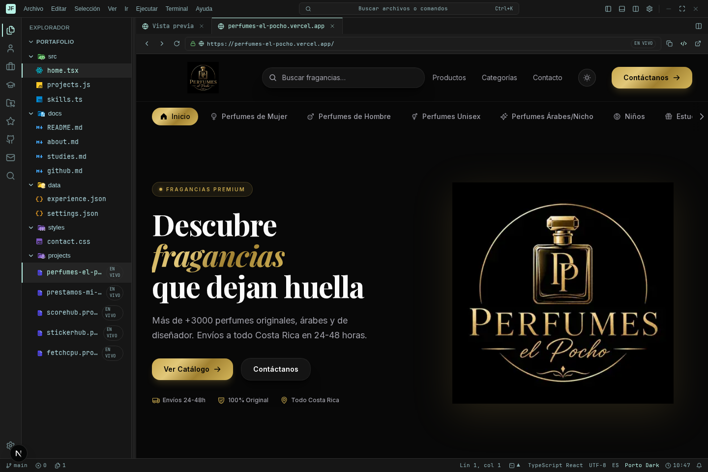
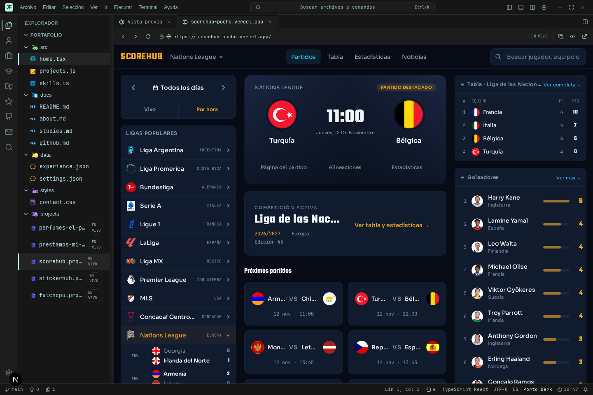
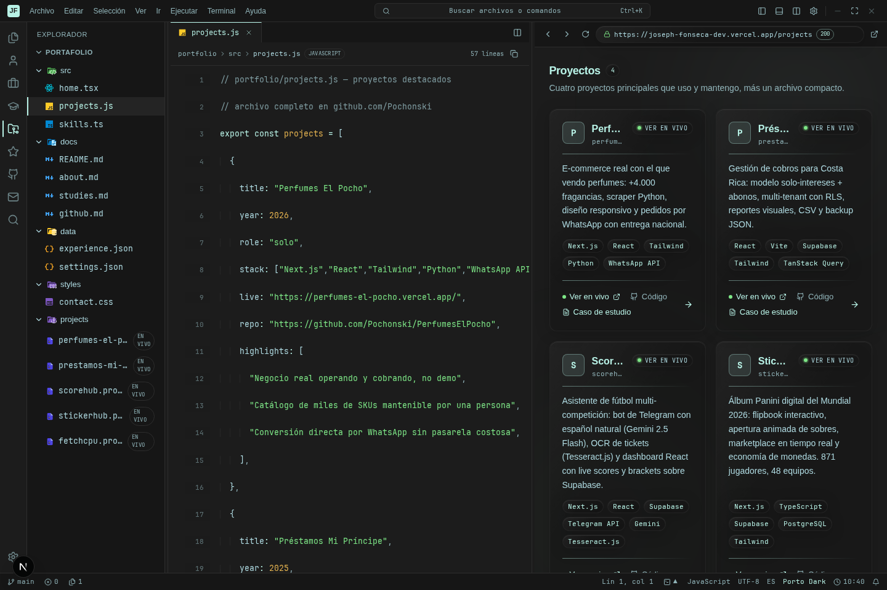
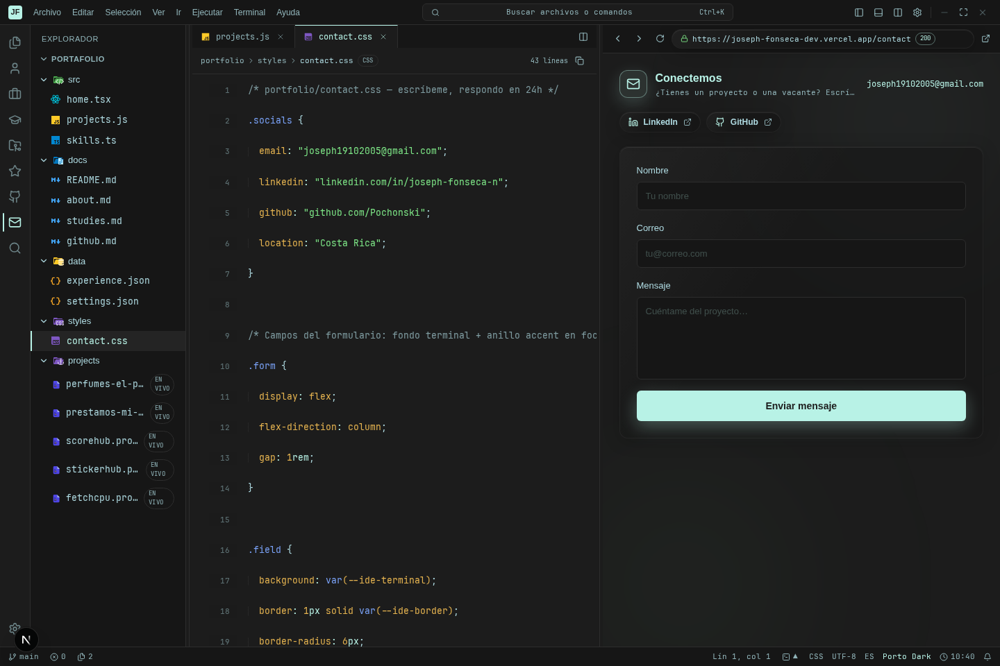

<div align="center">

# Joseph Fonseca — Portfolio

### Un portfolio bilingüe que se siente como un workspace de VS Code.

Explora proyectos, experiencia y contacto dentro de un IDE interactivo construido para contar la historia detrás del código.

[Ver portfolio](https://joseph-fonseca-dev.vercel.app) · [Ver proyectos](https://joseph-fonseca-dev.vercel.app/projects) · [Contactar](https://joseph-fonseca-dev.vercel.app/contact)

<br />

`Next.js 16` · `React 19` · `TypeScript` · `Tailwind CSS` · `next-intl`

</div>



<div align="center">

**No es una landing convencional.** Es una experiencia editorial para navegar un perfil profesional como si fuera un proyecto vivo.

</div>

## La experiencia

| Explora | Entiende | Conecta |
| :--- | :--- | :--- |
| Navega archivos, tabs, búsqueda, terminal, atajos y proyectos desplegados como archivos `.project`. | Lee casos de estudio, stack, decisiones y resultados sin salir de la interfaz. | Envía un mensaje desde un formulario protegido contra spam y validado de punta a punta. |
| `Explorer` · `.project` · `Split view` | `Proyectos` · `Experiencia` · `GitHub` | `Resend` · `Zod` · `Rate limit` |

### Proyectos en producción, dentro del portfolio

Los archivos `.project` no son simples enlaces. Al abrir uno desde el Explorer, el portfolio crea una pestaña de navegador aislada para ese proyecto: conserva su propia URL, permite alternar entre demos y mantiene el workspace alrededor.



**Perfumes El Pocho** se abre sin abandonar el workspace: catálogo, navegación y llamadas a la acción viven dentro de una pestaña del IDE.



**ScoreHub** demuestra que es una capacidad reutilizable: el archivo `scorehub.project` abre una segunda aplicación con su propia navegación, datos y vista de competición.

### Proyectos como código que se puede explorar



El panel izquierdo mantiene el archivo fuente y el derecho convierte su contenido en una vista legible. Es una forma intencional de mostrar que los proyectos no son solo capturas: están respaldados por decisiones técnicas concretas.

### Contacto sin romper la experiencia



El formulario vive dentro del mismo sistema visual, usa validación compartida entre cliente y servidor y conserva defensas prácticas contra abuso, sin añadir fricción con CAPTCHA.

## Qué incluye

- **Bilingüe por defecto.** Español en `/` e inglés en `/en`, con rutas, metadata y Open Graph localizados.
- **Workspace persistente.** El tema, paneles, tabs recientes y preferencias sobreviven recargas en el navegador.
- **IDE funcional.** Explorer, búsqueda de archivos, paleta de comandos, terminal, divisiones redimensionables y navegación por teclado.
- **Demos embebidas.** Los `.project` permitidos se abren en tabs de navegador internos; cada uno conserva su navegación independiente.
- **Proyectos reales.** Casos de estudio, demos en vivo y código fuente enlazado desde una misma interfaz.
- **GitHub resiliente.** Perfil y repositorios con caché horaria y un estado de respaldo cuando la API no está disponible.
- **Diseñado para producción.** Tipos estrictos, pruebas unitarias y E2E, CSP, metadatos, sitemap, robots e imágenes sociales.

## Stack

| Capa | Herramientas |
| --- | --- |
| Aplicación | Next.js 16 · App Router · React 19 |
| Lenguaje | TypeScript estricto |
| Interfaz | Tailwind CSS 4 · tokens CSS · Lucide |
| Internacionalización | next-intl |
| Datos y formularios | Zod · Resend |
| Código | Shiki · DOMPurify |
| Calidad | ESLint · Vitest · Playwright |
| Observabilidad | Vercel Analytics · Google Analytics opcional |

## Arquitectura, en breve

```text
src/
├── app/          rutas, metadata, sitemap, robots y APIs
├── components/   shell del IDE, previews y formulario de contacto
├── content/      proyectos, habilidades y casos de estudio tipados
├── i18n/         routing y catálogos es/en
└── lib/          seguridad, Shiki, GitHub, cachés y preferencias
```

| Superficie | Responsabilidad |
| --- | --- |
| `app/[locale]` | Páginas localizadas: inicio, proyectos, perfil, GitHub y contacto. |
| `components/ide` | La experiencia de editor: explorer, tabs, comandos, terminal y split view. |
| `app/api/contact` | Recepción, validación, rate limit y entrega de mensajes mediante Resend. |
| `app/api/source` | Carga bajo demanda del código resaltado que alimenta el editor. |
| `content` | Fuente de verdad para el contenido visible del portfolio. |

## Empezar a trabajar

**Requisitos:** Node.js `>=20 <23` y npm 10+.

```bash
git clone <tu-fork-o-url-del-repositorio>
cd NewPortfolio
npm install
cp .env.example .env.local
npm run dev
```

Abre [http://localhost:3000](http://localhost:3000). El idioma inicial toma `Accept-Language`; visita `/en` para abrir la versión inglesa.

### Comandos

| Comando | Resultado |
| --- | --- |
| `npm run dev` | Inicia el entorno local. |
| `npm run lint` | Ejecuta ESLint. |
| `npm run test:unit` | Corre las pruebas de Vitest. |
| `npm run test:e2e` | Corre Playwright contra desarrollo. |
| `npm run build` | Genera el build de producción. |
| `npm run start` | Sirve el build generado. |
| `npm run test:e2e:prod` | Verifica el build con Playwright. |

## Configuración

Copia `.env.example` a `.env.local` y completa únicamente lo que vayas a usar. Las claves nunca deben confirmarse al repositorio.

| Variable | Requerida | Propósito |
| --- | :---: | --- |
| `NEXT_PUBLIC_SITE_URL` | Producción | Origen canónico para metadata, sitemap, robots y preview interno. |
| `RESEND_API_KEY` | Para correo | Credencial privada de Resend. |
| `CONTACT_TO` | Producción | Destinatario de los mensajes. |
| `CONTACT_FROM` | Producción | Remitente verificado en Resend. |
| `GITHUB_TOKEN` | No | Aumenta el límite de GitHub API. |
| `NEXT_PUBLIC_GA_MEASUREMENT_ID` | No | Activa Google Analytics. |

## Principios de seguridad

- El endpoint de contacto valida cada campo con Zod y rechaza orígenes cruzados.
- Honeypot, trampa de tiempo y límite de 5 envíos por IP/minuto reducen el spam sin CAPTCHA.
- La política CSP, HSTS, `X-Frame-Options` y `Referrer-Policy` se definen en `next.config.ts`.
- Shiki genera el HTML de código en servidor; DOMPurify lo sanea antes de insertarlo en el cliente.
- Las claves de Resend y GitHub se quedan en servidor; solo las variables `NEXT_PUBLIC_*` llegan al navegador.

> El rate limit actual es local a cada instancia. Para una arquitectura multi-instancia, usa un almacén compartido como Upstash Redis.

<details>
<summary><strong>Guía de contenido y personalización</strong></summary>

<br />

- Actualiza proyectos y estudios desde `src/content/`.
- Traduce textos de interfaz en `messages/es.json` y `messages/en.json`.
- Define temas y tokens visuales en `src/lib/themes.ts` y `src/app/globals.css`.
- Añade archivos al workspace virtual desde `src/lib/files.ts` y `src/lib/file-sources.ts`.
- Cambia el origen público con `NEXT_PUBLIC_SITE_URL`; vuelve a crear el build después.

</details>

<details>
<summary><strong>Lista corta de despliegue</strong></summary>

<br />

1. Configura las variables de entorno en el proveedor de hosting.
2. Define `NEXT_PUBLIC_SITE_URL` con el dominio HTTPS definitivo, sin rutas.
3. Verifica el dominio remitente de Resend antes de configurar `CONTACT_FROM`.
4. Ejecuta lint, pruebas unitarias y build antes de publicar.
5. Comprueba `/sitemap.xml`, `/robots.txt`, las imágenes sociales y un envío real de contacto.

</details>

---

<div align="center">

Hecho con intención en Costa Rica · © Joseph Fonseca

</div>
